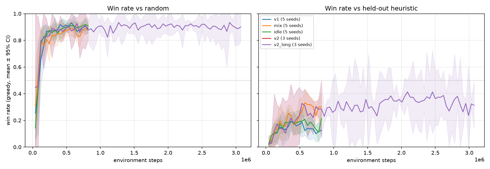
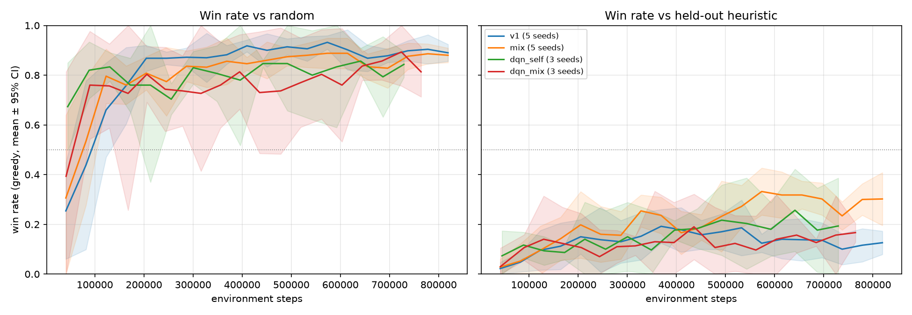

# Multi-Agent Dodgeball RL

A 6-vs-6 dodgeball game built as a multi-agent reinforcement learning environment
([PettingZoo](https://pettingzoo.farama.org/) `ParallelEnv`), with Deep Q-Network (DQN) and
Proximal Policy Optimisation (PPO) agents trained through self-play.

Originally built for a university *Designing Intelligent Agents* coursework module. I'm now
cleaning it up and extending it.

> **Status: work in progress.** The environment has been rewritten and is covered by a test
> suite, which includes PettingZoo's API test and a fairness check. The DQN and PPO trainers
> have had their bugs fixed (see [Training fixes](#training-fixes)). Agents are now evaluated
> against a scripted heuristic during training; multi-seed baseline results are next.

## The game

```
 row 0  ● ● ●   ● ●   ●   team blue (agents 0-5)
        .   .   .   .
 ──────────────────────   half-way line (cannot be crossed)
        .   .   .   .
 row 15 ● ● ●   ● ●   ●   team red (agents 6-11)
```

- **Court:** 16 × 8 grid, split into two 8 × 8 halves. 5 balls start in players' hands on the
  back rows; a random team gets the odd ball.
- **Actions (11):** stay, forward, back, left, right, or throw at one of the opponents still
  in play. Invalid actions are hidden with an action mask (`infos[agent]["action_mask"]`).
- **Throwing:** the chance of a hit falls with distance. It goes up when teammates throw at
  the same target in the same step, and goes down if the target is holding a ball they aren't
  throwing (they can block). A player who is hit is out, and thrown balls land on the
  target's square. All throws in a step are resolved at the same time.
- **Possession rule:** the team with more balls on its half has 10 steps to throw. If it
  doesn't, every player on that team who is holding a ball is out.
- **End of game:** one team is eliminated, or 300 steps pass. The team with more players left
  wins.

### Observations (520 values per agent)

Observations are **egocentric**: red's view is flipped so every agent sees its own half at the
top, and "forward" always means towards the half-way line. A blue player and a red player in
mirrored positions get identical inputs, so one shared network can play either side.

| Part | Size | Contents |
|---|---|---|
| Court grid | 4 × 16 × 8 | teammates, opponents, balls, the agent itself |
| Extra features | 8 | time left, both possession timers, balls on each half, holding a ball, players alive on each team |

The grid comes first in the vector and can be reshaped to `env.grid_shape` for a CNN.

### Rewards

Set in `RewardConfig` in [`dodgeball/env.py`](dodgeball/env.py):

| Event | Reward |
|---|---|
| Throw hits | +1.0 |
| Throw misses | −0.05 |
| Eliminated | −1.0 |
| Pick up a ball | +0.1 |
| Team wins / loses / draws (players still in play) | +2 / −2 / 0 |

Options for experiments (all off by default, so the defaults reproduce v1). Set them with
`train.py --reward FIELD=VALUE`:

| Field | Effect |
|---|---|
| `win_on_numbers`, `lose_on_numbers` | separate reward when time runs out and one team has more players left (e.g. +1 / −1); a true draw stays 0 |
| `terminal_to_eliminated` | the win/lose reward also goes to players eliminated earlier, via `env.late_rewards`. The trainers add it to that player's last transition |
| `idle` | penalty for staying put when another action was available (e.g. −0.01) |

`pickup` can't be farmed: a player carries every ball on their square, so stepping on and
off never finds a loose ball again (there's a test for this).

## Agents

Every player on both teams uses one shared network, so each agent learns by playing against
copies of itself.

| Agent | File | Notes |
|---|---|---|
| DQN | [`dodgeball/agents/dqn.py`](dodgeball/agents/dqn.py) | MLP Q-network, replay buffer, soft-updated target network, masked ε-greedy |
| PPO | [`dodgeball/agents/ppo.py`](dodgeball/agents/ppo.py) | Shared actor-critic MLP, clipped objective, GAE |

## Evaluation

The total self-play reward isn't a useful measure of progress, because both teams are the
same network and improve together. Instead, every few iterations `train.py` plays the current
network against three fixed opponents, with half the games on each side. Every evaluation
uses **greedy** actions (the highest-scoring valid action, for both DQN and PPO):

| Opponent | What it does | Strength |
|---|---|---|
| Random | uniformly random valid action | baseline (50% vs itself) |
| Scripted heuristic | throws at the target with the best hit chance once it's ≥ 60% (or when the possession timer is nearly up), otherwise walks forward; without a ball it fetches the nearest loose ball, or backs away when the opponents hold the balls | wins ~97% vs random |
| Held-out variant | the same script, but waits for a ≥ 70% shot and only panic-throws on the last step. Never used in training | beats the standard heuristic ~60% |

The heuristic ([`dodgeball/policies.py`](dodgeball/policies.py)) only sees the same
observation and action mask as the learned agents.

The results are written to `<out-dir>/<algo>_eval.csv`, together with pickups and throws per
game and the fraction of time spent idle. Each evaluated network is saved in
`<out-dir>/ckpts/`. The checkpoint with the best win rate against the **standard** heuristic is
saved as `<algo>_best.pt`. The held-out variant is never used for training or for choosing
checkpoints, so it stays an independent test.

### Controlled experiments

[`experiments.py`](experiments.py) runs each change on top of the v1 baseline, **one change
at a time**, over several seeds, with the same training budget and evaluation for every run.
That evaluation uses greedy actions, 500 games against each opponent and fixed game seeds.
Every run's config and results are appended to `results/experiments.csv`, and `report` writes
`results/summary.md` (mean ± 95% CI over seeds) and `results/learning_curves.png`.

```bash
python experiments.py list                                  # what each experiment changes
python experiments.py run v1 advnorm mix --seeds 0 1 2 --jobs 5
python experiments.py run v1 --seeds 3 4                    # add seeds; finished runs are skipped
python experiments.py report
python experiments.py eval-checkpoint my_label dqn:runs/dqn_20k_s0/dqn_best.pt   # older runs
```

### Opponent mixing

With pure self-play the network only ever plays its current self. In 20,000-episode DQN runs
the best checkpoint beat the heuristic ~36% of the time, but the final one fell to 16–25%:
the strategy drifted and forgot how to beat other styles. The trainers can instead pick an
opponent for each episode (see [`dodgeball/agents/opponents.py`](dodgeball/agents/opponents.py)):

| Hyperparameter | Opponent | Default |
|---|---|---|
| `P_SELF` | the current network (both teams learn) | 1.0 |
| `P_HEURISTIC` | the scripted heuristic | 0.0 |
| `P_PAST` | a frozen snapshot of the network, taken every `SNAPSHOT_EVERY` iterations; the last `POOL_SIZE` are kept | 0.0 |
| `P_RANDOM` | the random policy | 0.0 |

Against a fixed opponent only the learning team's experience is stored. The learning team
switches sides every episode. Observations are egocentric, so one side would do, but switching
cancels out small asymmetries such as move order. The held-out variant exists because once
the heuristic is a training opponent, beating it is no longer an independent test.

```bash
python train.py dqn --episodes 20000 --seed 0 --out-dir runs/dqn_mix_20k_s0 \
  --hp P_SELF=0.5 --hp P_HEURISTIC=0.25 --hp P_PAST=0.25
```

## Results

PPO, 400 updates (~0.8M environment steps) unless stated. Final checkpoint, 500 greedy games
per opponent per run, mean ± 95% CI over seeds. Full tables, including each run's best
checkpoint, are in [`results/summary.md`](results/summary.md).

| Config | Seeds | Win vs random | Win vs held-out heuristic |
|---|---|---|---|
| v1: self-play, original rewards | 5 | 91.2% ± 1.8 | 14.4% ± 4.6 |
| time-out win/loss on numbers = ±1 | 3 | 89.7% ± 4.5 | 16.3% ± 27.0 |
| terminal reward to eliminated players | 3 | 88.1% ± 5.0 | 16.0% ± 16.0 |
| pickup reward = 0 | 3 | 91.1% ± 7.2 | 14.5% ± 3.3 |
| miss penalty = 0 | 3 | 89.7% ± 8.8 | 13.1% ± 14.9 |
| only win/lose rewards | 3 | 78.2% ± 19.4 | 5.3% ± 4.5 |
| idle penalty −0.01 | 5 | 91.5% ± 2.3 | 21.7% ± 3.5 |
| advantage normalisation | 5 | 91.1% ± 3.6 | 18.0% ± 10.7 |
| **opponent mix** (40% self, 30% past, 20% heuristic, 10% random) | 5 | 87.2% ± 2.6 | **28.6% ± 9.0** |
| v2 = mix + idle penalty | 3 | 90.5% ± 4.3 | 27.6% ± 19.4 |
| **v2, 1500 updates** | 3 | 92.0% ± 3.4 | **30.2% ± 5.5** (best checkpoint 35.9% ± 6.0) |



What the experiments show:

- **Opponent mixing is the change that matters.** It doubles the win rate against the
  held-out heuristic (14% → 29%), and the 95% CIs don't overlap over 5 seeds. It also shrinks
  the gap between the best and final checkpoint: pure self-play forgets how to beat other
  styles as it trains.
- **The shaping rewards are needed.** With only win/lose rewards the agent barely learns in
  this budget (5% vs the held-out heuristic).
- **The other reward changes made no measurable difference.** The idle penalty gives a small
  gain on its own and cuts idle time (34% → 20–26%), but it adds nothing measurable on top of mixing.
- **Longer training helps a little, then plateaus.** v2 peaks at ~35–40% around 700–1000
  updates and is ~30% at 1500. The agents beat random reliably, but they still lose most games
  against the held-out heuristic.
(v2 and v2 at 1500 updates use the same seeds, so their curves are identical for the first
400 updates, which shows that runs are reproducible.)

### DQN vs PPO at the same budget

Both get 819,200 environment steps (`--env-steps` for DQN), v1 rewards, the same evaluation
and the same best-checkpoint rule. DQN's replay buffer is 200k transitions, not the 5M default,
so that 3 runs fit in 8 GB of RAM; this is recorded in each run's `config.json`.

| Config | Seeds | Final: vs random | Final: vs held-out | Best: vs held-out | Best: vs standard heuristic |
|---|---|---|---|---|---|
| PPO self-play (v1) | 5 | 91.2% ± 1.8 | 14.4% ± 4.6 | 21.4% ± 6.7 | 27.6% ± 8.0 |
| PPO + opponent mix | 5 | 87.2% ± 2.6 | **28.6% ± 9.0** | **32.2% ± 3.8** | 31.8% ± 5.6 |
| DQN self-play | 3 | 88.9% ± 4.9 | 20.2% ± 3.9 | 20.5% ± 12.9 | 24.7% ± 3.8 |
| DQN + opponent mix | 3 | 81.7% ± 16.5 | 19.3% ± 8.1 | 17.6% ± 3.9 | 28.9% ± 6.2 |



(DQN evaluates every 500 episodes, so its curves stop where the shortest seed's last
in-training evaluation was, ~0.75M steps. The table's final row is at 0.82M.)

- **With self-play, DQN and PPO are about equal.** DQN's final checkpoint is slightly
  better against the held-out heuristic (20% vs 14%), but the CIs overlap. It also forgets less
  between its best and final checkpoints.
- **Opponent mixing helps PPO but not DQN.** DQN with mixing is no better than DQN self-play,
  and its best checkpoint is clearly behind PPO with mixing (18% ± 4 vs 32% ± 4). DQN with mixing
  beats the *standard* heuristic, which it trains against (29%), much more often than the held-out
  one (18%). So it seems to learn that specific opponent rather than general play. PPO with mixing
  scores about the same against both. A likely cause: DQN's replay buffer keeps learning from old
  games against past opponents, while PPO only learns from its latest games.
- **DQN costs more compute.** It does a gradient step on every environment step: ~1 hour per
  run alone, versus about the same for PPO with 6 runs in parallel.
- **Overall, PPO with opponent mixing is the best configuration found.** DQN is no better than
  PPO at this budget.

## Usage

```bash
python -m venv venv && source venv/bin/activate
pip install -r requirements.txt

# Run the tests
pytest

# Train one run (writes <algo>.pt, <algo>_best.pt, <algo>_eval.csv, <algo>_rewards.csv)
python train.py ppo --updates 300 --seed 0 --out-dir runs/ppo_s0
python train.py dqn --episodes 3000 --seed 0 --out-dir runs/dqn_s0

# Override hyperparameters (saved to <out-dir>/config.json); name the dir <variant>_s<seed>
python train.py ppo --hp LR=1e-4 --hp EPOCHS=8 --seed 0 --out-dir runs/ppo_lr1e-4_s0

# Train both algorithms on seeds 0, 1 and 2, then plot the learning curves
for s in 0 1 2; do
  python train.py ppo --updates 300 --seed $s --out-dir runs/ppo_s$s &
  python train.py dqn --episodes 3000 --seed $s --out-dir runs/dqn_s$s &
  wait
done
python plot.py runs/*/ --out results/learning_curves.png

# Evaluate: first policy plays blue, second plays red (--swap alternates sides)
python evaluate.py heuristic random --games 500 --swap
python evaluate.py ppo:runs/ppo_s0/ppo_best.pt heuristic --games 1000 --swap

# Watch a game
python evaluate.py ppo:runs/ppo_s0/ppo_best.pt heuristic --games 1 --render
```

## Project layout

```
dodgeball/
  env.py          game rules, observations, rewards (PettingZoo ParallelEnv)
  entities.py     Player and team constants
  policies.py     random / heuristic / network policies, head-to-head evaluation
  render.py       Tkinter court viewer
  agents/
    dqn.py        DQN network + trainer
    ppo.py        PPO network + trainer
tests/            pytest suite: game rules, rewards, policies, opponent mixing
train.py          training entry point, with periodic evaluation
evaluate.py       head-to-head evaluation (random / heuristic / dqn / ppo)
plot.py           learning curves across seeds
experiments.py    one-change-at-a-time experiments over seeds, results CSV, CI report
```

## Environment fixes

Rewriting the environment fixed these bugs from the original version. Each one has a
regression test.

- **Red had an advantage** (about 54% vs 45% in random play). Three causes:
  - When red's possession timer ran out, blue ball holders were eliminated as well.
  - Red could throw at its own teammates.
  - Throws were resolved one at a time, so whether a target could block depended on the
    order. Random play is now 50 / 50.
- **Wrong player penalised:** possession penalties were always given to the first agent in
  the list.
- **End-of-game reward:** the losing team got `True`/`False` instead of a negative reward.
- **Observation bugs:**
  - Position features were rounded to 0/1.
  - The possession-timer feature always showed red's timer.
  - The declared observation size didn't match the real one.
- **Reward shaping:** agents were paid for moving and penalised for standing still, which
  encouraged aimless wandering. That shaping has been removed.

## Training fixes

These bugs in the original trainers have been fixed. The hyperparameters and network sizes
are unchanged.

**DQN**
- ε now decays as intended. Previously `steps_done` was never incremented outside
  `select_action`, so ε stayed at 0.9 for the whole of training.
- The update target `max_a Q(s', a)` now only considers valid actions. Invalid actions are
  never taken, so their Q-values were never trained and drifted upwards, and the max kept
  picking them. Q-values diverged to around 700, and the policy learned to stand still and
  never throw.

**PPO**
- **Actions:** stored as indices. Previously every update trained on action 0, because actions
  were written across an 11-wide row and read back with `argmax`.
- **Advantages:** GAE now includes the next state's value and is computed separately along
  each agent's own trajectory. Previously all agents were interleaved in one buffer.
- **Action mask:** also applied during the update, so the new and old log-probabilities are
  measured on the same distribution.
- **Observations:** no longer overwritten with the buffer tensor after each update.

## Roadmap

1. ~~Restructure into a package, remove dead code, add training/evaluation scripts~~
2. ~~Fix the environment bugs and add unit tests for the game rules~~
3. ~~Fix the DQN and PPO training bugs~~
4. ~~Report win rates against a random baseline and a scripted heuristic opponent, across
   several seeds, with learning curves~~ (see [Results](#results))
5. Gameplay GIF; a curriculum (random → heuristic → self-play); a CNN instead of the MLP for
   the grid observation
